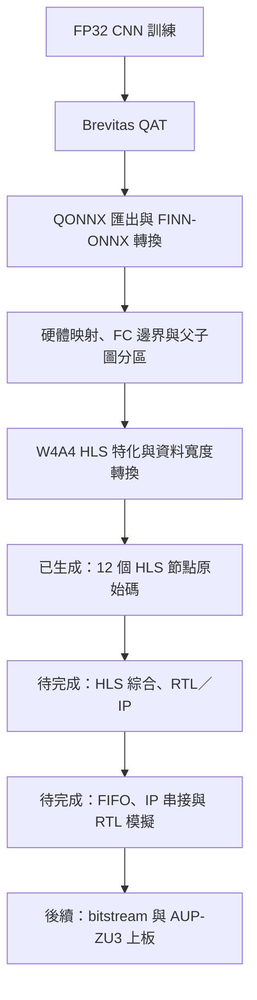

# acc_ai — MNIST CNN 量化與 FPGA 加速

使用 PyTorch／Brevitas 建立 MNIST CNN 與量化感知訓練（QAT），經 QONNX、FINN-ONNX 轉換及硬體資料流準備，探索 AUP-ZU3 上的 FPGA 加速流程。

**目前 W4A4 硬體流程已生成 12 個節點的 HLS C++、參數與 Tcl；HLS 綜合、完整核心 RTL 模擬及上板測試尚未完成。**

文件更新：2026-10-12。以下進度依儲存庫內既有程式與 2026-09-30 報告整理，本次文件更新未重新訓練或執行硬體建置。

## 專案結構

| 路徑 | 內容與入口 |
|---|---|
| [mn/](mn/README.md) | FP32 CNN、QAT 訓練／測試、QONNX 匯出與 FINN 轉換；包含 MNIST 資料、checkpoint 與實驗紀錄。 |
| [mnist_hw_prepare/](mnist_hw_prepare/README.md) | 圖整理、streamline、硬體節點映射、FC 邊界處理與資料流分區。 |
| [aup_zu3_w4a4/](mnist_hw_prepare/aup_zu3_w4a4/README.md) | W4A4 核心的 AUP-ZU3 建置設定、HLS 原始碼、驗證資料及分段計時報告。 |
| [mnist_cnn/](mnist_cnn/) | 獨立的量化 CNN 原型與未訓練權重匯出 smoke test，另保存原工作環境的 `.venv`／`.venv-finn`。 |
| [finn/](finn/README.md) | 專案使用的 FINN 原始碼快照。 |
| [docs/](docs/AUP_ZU3_HLS_RTL_FLOW.md) | 初期 HLS／RTL 流程規劃；其中「尚未包含模型」屬歷史狀態，實際進度以硬體專案 README 與報告為準。 |

## 流程與目前進度



- `mn/runs_qat/` 保存 W2A2、W3A3、W4A4、W6A6、W8A8、W4A8、W8A4 的實驗紀錄；W 表示權重位元數，A 表示 activation 位元數。
- 既有 W4A4 硬體核心包含 8 個原始硬體節點；加入 4 個資料寬度轉換器（DWC）後生成 12 份 HLS C++。
- 18 筆合成輸入的 Python 參考比對結果一致。這項結果不代表完整 MNIST 測試準確率，也不代表生成的 C++／RTL 已通過模擬。
- 既有工具鏈檢查因缺少 Vivado／Vitis HLS 而標記 `blocked`；尚無完整硬體建置結果。
- `mnist_cnn/` 的 smoke test 與 `mn/` 的訓練流程使用不同模型；既有硬體核心與特定訓練 checkpoint 的對應須另行核對。

詳見 [12 份 HLS C++ 的用途與位置](mn/README.md)、[逐層規格與 PE／SIMD 候選](mnist_hw_prepare/core_specs_w4a4/README.md)及 [三次原始碼生成統計](mnist_hw_prepare/aup_zu3_w4a4/reports/baseline_summary.json)。

## 取得完整檔案

此儲存庫保存整個工作目錄快照，包含資料、模型、建置產物及 Python 虛擬環境；內嵌 `.git` 管理資料未納入。大型 PyTorch 函式庫透過 Git LFS 儲存。

請先安裝 Git 與 Git LFS，並在 Linux 或 WSL 的 Linux 檔案系統中執行：

```bash
git lfs install
git clone https://github.com/bogerneal/acc_ai.git
cd acc_ai
git lfs pull
```

若已完成 clone，只需在儲存庫目錄執行 `git lfs pull`。完整內容約 1.3 GB，另需預留 Git 物件與後續建置空間。部分檔名含冒號且包含符號連結，請使用 Linux／WSL 路徑，避免直接 checkout 到 Windows NTFS 目錄。

## 執行入口

以下命令假設目前位於儲存庫根目錄，且已啟用具備對應相依套件的 Python 環境。訓練主要使用 PyTorch／torchvision／Brevitas；匯出與硬體轉換另需 ONNX、QONNX、FINN 等套件。環境與完整參數請參考各子專案文件及既有報告。

### FP32 訓練與 QAT

```bash
cd mn
python mnist_cnn.py check
python mnist_cnn.py train --epochs 5 --device cpu
```

將下列 `<FP32實驗目錄>` 替換為前一步實際產生的目錄，再啟動 W4A4 QAT：

```bash
python mnist_qat.py train \
  --checkpoint runs/<FP32實驗目錄>/best.pth \
  --wbits 4 --abits 4 --epochs 5
```

模型測試、匯出及 FINN 轉換步驟見 [mn/README.md](mn/README.md)。新實驗應保留 checkpoint、量化設定與獨立輸出目錄。

### W4A4 硬體原始碼生成

確認 FINN Python 環境及相依路徑就緒後，從儲存庫根目錄執行：

```bash
cd mnist_hw_prepare/aup_zu3_w4a4
python scripts/build_hls_rtl.py
```

預設以新時間戳建立輸出目錄；本入口執行前置準備、Python 參考驗證及 HLS 原始碼生成。後續工具鏈設定與層級綜合入口見 [AUP-ZU3 建置說明](mnist_hw_prepare/aup_zu3_w4a4/README.md)。

| 基準項目 | 既有設定 |
|---|---|
| FPGA part | `xczu3eg-sfvc784-2-e` |
| HLS 目標週期 | 10 ns，為綜合約束，非實測時脈 |
| 四個 MVAU 並行度 | PE=1、SIMD=1 |
| FINN commit | `39f0c9a6b7675f62d47390fbf9a591707bcbac9b` |
| 既有文件指定的工具版本 | Vivado／Vitis HLS 2022.2；執行前仍須確認器件支援與授權 |

## 環境與重現注意事項

- 已提交的虛擬環境是原機快照，可能引用原機的 Python、絕對路徑或 editable 套件；換機時需依子專案記錄重建環境與相依設定。
- 部分 ONNX、Tcl 與建置產物保存 `/home/za_warudo/projects/` 下的絕對路徑。換目錄後應調整設定並重新生成產物。
- 本儲存庫未提供涵蓋所有子專案的統一安裝入口；請依所需階段使用對應環境。
- 保留的第三方原始碼與套件依其各自授權使用，例如 [FINN 授權](finn/LICENSE.txt)。
