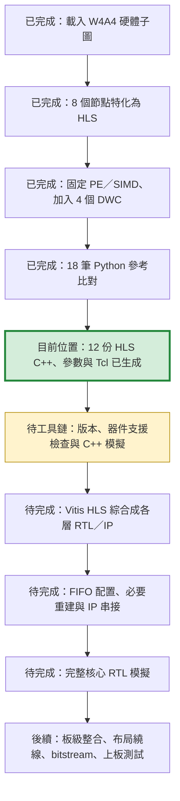

# mn 專案檔案說明

更新日期：2026-09-30。本次核對 W4A4 的 12 份 HLS C++ 與建置報告，補充逐檔用途及硬體進度。訓練、測試與目錄清單沿用 2026-09-27 的紀錄；本次文件更新未重新執行訓練、綜合或模擬。

## 專案用途與流程

本專案使用 MNIST 手寫數字資料，建立 FP32 CNN 基準模型，使用 Brevitas 進行量化感知訓練（QAT），再匯出 QONNX 並轉換為 FINN-ONNX，檢查轉換前後的數值一致性。

```text
data/MNIST/raw/
    │
    ▼
mnist_cnn.py train ──► runs/<實驗>/best.pth
    │                            │
    │ export                     │ mnist_qat.py train
    ▼                            ▼
export_fp32/              runs_qat/<實驗>/best_qat.pth
                                 │ mnist_qat.py export
                                 ▼
                           export_qonnx/
                                 │ convert_mnist_finn.py
                                 ▼
                           finn_check_<時間>/
                                 │ 後續工作位於 ../mnist_hw_prepare/
                                 ▼
                     硬體映射 → FC 邊界整理 → 父子圖分區
                                 │ W4A4 子圖
                                 ▼
                     HLS 特化 → 資料寬度轉換 → HLS C++（已生成）
                                 │ Vitis HLS（待工具鏈）
                                 ▼
                     各層 RTL／IP → FIFO／串接 → RTL 模擬（待完成）
```

`mn/` 負責訓練、測試及模型匯出；後續硬體流程位於相鄰的 [mnist_hw_prepare](../mnist_hw_prepare/README.md)。目前 W4A4 已生成各節點 HLS C++，尚未完成 HLS 綜合後 RTL／IP、完整核心 RTL 模擬、bitstream 或板上量測。這項硬體進度只針對既有 W4A4 子圖，不代表其他量化組也完成同樣流程，亦不據此認定它來自下方最新 W4A4 訓練紀錄。

## HLS／RTL 目前進度（2026-09-30）

專案位置：[aup_zu3_w4a4](../mnist_hw_prepare/aup_zu3_w4a4/README.md)。基準為 AUP-ZU3 晶片 `xczu3eg-sfvc784-2-e`、HLS 目標週期 10 ns；四個 MVAU 維持 PE=1／SIMD=1。10 ns 是約束，不是已達成時脈。



| 階段 | 實際狀態與證據 |
|---|---|
| 輸入／環境保存 | 已保存父子圖、測試資料、上游腳本、SHA-256 與版本。FINN commit：`39f0c9a6b7675f62d47390fbf9a591707bcbac9b`。 |
| 後端與介面 | 8 個原始節點和 4 個 DWC 均選 HLS；已檢查相鄰串流位寬與元素數匹配。 |
| Python 參考驗證 | 18 筆既有合成輸入，每筆 batch=1，核心輸出逐元素一致、最大誤差 0。不是 MNIST 10,000 張準確率，也沒有執行生成的 C++。 |
| HLS 原始碼 | `baseline_r1`～`baseline_r3` 三次獨立生成完成，每次 12 份 `top_*.cpp`；[第一輪報告](../mnist_hw_prepare/aup_zu3_w4a4/reports/baseline_r1.json)。 |
| 工具鏈與 HLS 綜合 | 已執行環境檢查，WSL 找不到 Vivado／Vitis HLS，報告為 `blocked`。此 FINN commit 的文件要求 2022.2，器件與授權尚待確認。 |
| C++／RTL 模擬與串接 | 尚未執行；既有環境檢查也缺少 `g++`／`verilator`。FIFO 深度、背壓、多筆串流及無死鎖均尚未驗證。 |

FIFO 配置可能觸發重新綜合及模擬，因此後續階段可能往返執行。現在完成的是**各層硬體原始碼生成**，不是完整 CNN RTL 已完成。

三次建置的耗時如下；[原始統計](../mnist_hw_prepare/aup_zu3_w4a4/reports/baseline_summary.json)不含工具安裝、下載、HLS 綜合或硬體執行：

| 項目 | 中位數（秒） | 最小～最大（秒） |
|---|---:|---:|
| 前置準備與特化 | 0.149 | 0.133～0.389 |
| DWC 插入與介面檢查 | 0.011 | 0.010～0.012 |
| Python 參考驗證 | 29.003 | 27.634～29.081 |
| HLS C++ 原始碼生成 | 1.773 | 1.592～1.792 |

## 12 份 HLS C++ 的位置與用途

以下依**資料流順序**說明 `baseline_r1` 的實際原始碼，共 2 個 SWU、4 個 MVAU、2 個 MaxPool、4 個 DWC。各檔名連結可直接開啟對應 C++。

原始碼根目錄：[baseline_r1/generated](../mnist_hw_prepare/aup_zu3_w4a4/build/aup_zu3/baseline_r1/generated)。每份位於 `code_gen_ipgen_<節點名稱>_<隨機碼>/top_<節點名稱>.cpp`。r2／r3 為相同配置的獨立重建，資料夾尾碼不同。

Windows 檔案總管位置：

```text
\\wsl.localhost\Ubuntu-22.04\home\za_warudo\projects\mnist_hw_prepare\aup_zu3_w4a4\build\aup_zu3\baseline_r1\generated
```

形狀中省略 batch=1，卷積資料使用 H×W×C。表中的串流位寬是 C++ `hls::stream<ap_uint<N>>` 的打包資料寬度；64／128-bit 串流不表示 activation 精度變成 64／128-bit。

| 順序 | C++ 檔案 | 主要工作與資料形狀 | 輸入 → 輸出串流位寬 |
|---:|---|---|---|
| 1 | [top_ConvolutionInputGenerator_0.cpp][hls-swu0] | 第一個 SWU：將 `28×28×1` 的 UINT8 影像，以 5×5、stride=1、無 padding 整理成 `24×24×25`。共有 576 個長度 25 的視窗；只做緩衝與排列，不做卷積乘加。SIMD=1。 | 8 → 8 bit |
| 2 | [top_MVAU_0.cpp][hls-mvau0] | 第一層卷積的乘加與閾值量化：每個視窗使用同一個 `25×16` INT4 權重矩陣，重複 576 次。輸入 UINT8，輸出 UINT4，形狀 `24×24×25 → 24×24×16`。 | 8 → 4 bit |
| 3 | [top_StreamingDataWidthConverter_0.cpp][hls-dwc0] | 將 MVAU_0 依序輸出的 16 個 4-bit 通道，打包成一個 64-bit 資料字供 MaxPool_0 使用。每張圖片 9,216 個 4-bit 資料字轉為 576 個 64-bit 資料字，數值與張量形狀不變。 | 4 → 64 bit |
| 4 | [top_StreamingMaxPool_0.cpp][hls-pool0] | 第一層 2×2 max pooling，stride=2；逐通道比較並取最大值，`24×24×16 → 12×12×16`。維持 UINT4；每個資料字攜帶 16 個通道。沒有權重乘法。 | 64 → 64 bit |
| 5 | [top_ConvolutionInputGenerator_1.cpp][hls-swu1] | 第二個 SWU：將 `12×12×16` 的 UINT4 特徵，以 5×5、stride=1、無 padding 整理成 `8×8×400`。每個視窗涵蓋 `5×5×16=400` 個數值，共 64 個視窗；SIMD=16，一個資料字攜帶同一位置的 16 個通道。 | 64 → 64 bit |
| 6 | [top_StreamingDataWidthConverter_1.cpp][hls-dwc1] | 將 SWU_1 的每個 64-bit 資料字拆成 16 個 4-bit 數值，配合 MVAU_1 的 SIMD=1。每張圖片 1,600 個 64-bit 資料字轉為 25,600 個 4-bit 資料字，維持 `8×8×400`。 | 64 → 4 bit |
| 7 | [top_MVAU_1.cpp][hls-mvau1] | 第二層卷積的乘加與閾值量化：每個視窗與 `400×32` INT4 權重矩陣相乘，重複 64 次，`8×8×400 → 8×8×32`；輸入／輸出皆 UINT4。每個卷積核涵蓋全部 16 個輸入通道。 | 4 → 4 bit |
| 8 | [top_StreamingDataWidthConverter_2.cpp][hls-dwc2] | 將 MVAU_1 的 32 個 4-bit 通道打包為一個 128-bit 資料字供 MaxPool_1 使用。每張圖片 2,048 個 4-bit 資料字轉為 64 個 128-bit 資料字，維持 `8×8×32`。 | 4 → 128 bit |
| 9 | [top_StreamingMaxPool_1.cpp][hls-pool1] | 第二層 2×2 max pooling，stride=2，逐通道取最大值，`8×8×32 → 4×4×32`；維持 UINT4，每個資料字包含 32 個通道。 | 128 → 128 bit |
| 10 | [top_StreamingDataWidthConverter_3.cpp][hls-dwc3] | 將 MaxPool_1 的 128-bit 資料字拆成 32 個 4-bit 值，供 SIMD=1 的 MVAU_2 依序接收。每張圖片 16 個 128-bit 資料字轉為 512 個 4-bit 資料字。僅重打包，沒有 NHWC→NCHW 的轉置。 | 128 → 4 bit |
| 11 | [top_MVAU_2.cpp][hls-mvau2] | 第一層全連接：把 `4×4×32=512` 個特徵作為一個向量，與 `512×128` INT4 權重矩陣相乘，再用閾值量化，輸出 128 個 UINT4 特徵。每張圖片執行一次完整矩陣向量運算。 | 4 → 4 bit |
| 12 | [top_MVAU_3.cpp][hls-mvau3] | 最後全連接：128 個 UINT4 特徵與 `128×10` INT4 權重矩陣相乘，輸出 10 個 INT32 核心分數。使用 `PassThroughActivation<ap_int<32>>`，沒有再量化成 UINT4，也不在此計算 softmax 或 argmax。 | 4 → 32 bit |

這 12 個節點的連接順序為：

```text
SWU_0 → MVAU_0 → DWC_0 → MaxPool_0
      → SWU_1 → DWC_1 → MVAU_1 → DWC_2 → MaxPool_1
      → DWC_3 → MVAU_2 → MVAU_3
```

### 如何閱讀這些 C++

- **SWU** 呼叫 `ConvolutionInputGenerator`（`slidingwindow.h`），本次產物指定 `ap_resource_lutram()` 作為緩衝記憶體資源偏好；實際資源須看綜合報告。
- **MVAU** 呼叫 `Matrix_Vector_Activate_Stream_Batch`（`mvau.hpp`）。`MW`／`MH` 是權重矩陣的輸入／輸出維度；`SIMD`／`PE` 控制平行度；`numReps` 分別是 576、64、1、1，並非時脈週期數。
- MVAU 的 `weights_V` 是獨立權重串流介面。本次四層皆為 `internal_decoupled`，生成目錄的 `memblock.dat`／`weights.npy` 保存權重資料，後續仍需記憶體串流包裝與整合。`ap_uint<4>` 的串流容器裝的是原始位元，乘法中以 `ap_int<4>` 解讀有號權重。
- MVAU_0～2 透過 `thresh.h` 內的閾值將較寬的累加結果映射成 UINT4。最後 MVAU_3 的介面雖為 `ap_uint<32>`，運算結果以 `ap_int<32>` 解讀；串流包裝型別不等於數值有號性。
- **MaxPool** 呼叫 `StreamingMaxPool_Precision`（`maxpool.h`），對每個通道的 2×2 區域做最大值比較。
- **DWC** 呼叫 `StreamingDataWidthConverter_Batch`（`streamtools.h`），只合併／拆開資料字，不改變每個數值的 4-bit 精度、不重新量化，也不改變模型權重。
- 上述檔案是 FINN HLS 函式庫的頂層封裝；核心實作位於 [finn-hlslib](../mnist_hw_prepare/aup_zu3_w4a4/deps/finn-hlslib)。不能只拿一份 `top_*.cpp` 當作不含相依套件的完整 CNN 程式。

父圖的輸入量化／Transpose、輸出的 Mul／Add 不在這 12 份 C++ 內。MVAU_3 輸出仍是子圖介面的整數分數，完整模型結果需要接回父圖後處理。前面 FC 邊界轉換已處理展平特徵的權重排列，這裡沒有再生成獨立 Flatten／Transpose 硬體。

[hls-swu0]: ../mnist_hw_prepare/aup_zu3_w4a4/build/aup_zu3/baseline_r1/generated/code_gen_ipgen_ConvolutionInputGenerator_0_q3uxnj3b/top_ConvolutionInputGenerator_0.cpp
[hls-mvau0]: ../mnist_hw_prepare/aup_zu3_w4a4/build/aup_zu3/baseline_r1/generated/code_gen_ipgen_MVAU_0_m23qpwbr/top_MVAU_0.cpp
[hls-dwc0]: ../mnist_hw_prepare/aup_zu3_w4a4/build/aup_zu3/baseline_r1/generated/code_gen_ipgen_StreamingDataWidthConverter_0_9kja8km5/top_StreamingDataWidthConverter_0.cpp
[hls-pool0]: ../mnist_hw_prepare/aup_zu3_w4a4/build/aup_zu3/baseline_r1/generated/code_gen_ipgen_StreamingMaxPool_0_f7zxspa8/top_StreamingMaxPool_0.cpp
[hls-swu1]: ../mnist_hw_prepare/aup_zu3_w4a4/build/aup_zu3/baseline_r1/generated/code_gen_ipgen_ConvolutionInputGenerator_1_o1qhd5yr/top_ConvolutionInputGenerator_1.cpp
[hls-dwc1]: ../mnist_hw_prepare/aup_zu3_w4a4/build/aup_zu3/baseline_r1/generated/code_gen_ipgen_StreamingDataWidthConverter_1_wo83p6yx/top_StreamingDataWidthConverter_1.cpp
[hls-mvau1]: ../mnist_hw_prepare/aup_zu3_w4a4/build/aup_zu3/baseline_r1/generated/code_gen_ipgen_MVAU_1_jalmkiuo/top_MVAU_1.cpp
[hls-dwc2]: ../mnist_hw_prepare/aup_zu3_w4a4/build/aup_zu3/baseline_r1/generated/code_gen_ipgen_StreamingDataWidthConverter_2_r1oajsa1/top_StreamingDataWidthConverter_2.cpp
[hls-pool1]: ../mnist_hw_prepare/aup_zu3_w4a4/build/aup_zu3/baseline_r1/generated/code_gen_ipgen_StreamingMaxPool_1_7748g1b4/top_StreamingMaxPool_1.cpp
[hls-dwc3]: ../mnist_hw_prepare/aup_zu3_w4a4/build/aup_zu3/baseline_r1/generated/code_gen_ipgen_StreamingDataWidthConverter_3_k6alfvh0/top_StreamingDataWidthConverter_3.cpp
[hls-mvau2]: ../mnist_hw_prepare/aup_zu3_w4a4/build/aup_zu3/baseline_r1/generated/code_gen_ipgen_MVAU_2_wqj68nml/top_MVAU_2.cpp
[hls-mvau3]: ../mnist_hw_prepare/aup_zu3_w4a4/build/aup_zu3/baseline_r1/generated/code_gen_ipgen_MVAU_3_6hf0r_fk/top_MVAU_3.cpp

## 目前目錄架構（2026-09-27）

~~~text
mn/
├── .vscode
├── __pycache__
│   ├── convert_mnist_finn.cpython-310.pyc
│   ├── mnist_cnn.cpython-310.pyc
│   ├── mnist_cnn.cpython-39.pyc
│   └── mnist_qat.cpython-310.pyc
├── 0.txt
├── convert_mnist_finn.py
├── convert_mnist_finn.pyZone.Identifier
├── data
│   └── MNIST
│       └── raw
│           ├── t10k-images-idx3-ubyte
│           ├── t10k-images-idx3-ubyte.gz
│           ├── t10k-labels-idx1-ubyte
│           ├── t10k-labels-idx1-ubyte.gz
│           ├── train-images-idx3-ubyte
│           ├── train-images-idx3-ubyte.gz
│           ├── train-labels-idx1-ubyte
│           └── train-labels-idx1-ubyte.gz
├── mnist_cnn.py
├── mnist_cnn.pyZone.Identifier
├── mnist_qat.py
├── mnist_qat.pyZone.Identifier
├── README.md
├── runs
│   └── 20260906_233834_241158
│       ├── best.pth
│       ├── export_fp32
│       │   ├── expected_output.npy
│       │   ├── input.npy
│       │   ├── mnist_fp32.onnx
│       │   └── verification.json
│       ├── history.csv
│       └── metrics.json
└── runs_qat
    ├── W2A2_seed42_20260927_222025_551894
    │   ├── best_qat.pth
    │   ├── history.csv
    │   └── metrics.json
    ├── W3A3_seed42_20260927_222157_727093
    │   ├── best_qat.pth
    │   ├── history.csv
    │   └── metrics.json
    ├── W4A4_seed42_20260927_222828_385542
    │   ├── best_qat.pth
    │   ├── history.csv
    │   └── metrics.json
    ├── W4A8_seed42_20260927_223235_272115
    │   ├── best_qat.pth
    │   ├── history.csv
    │   └── metrics.json
    ├── W6A6_seed42_20260927_222953_549166
    │   ├── best_qat.pth
    │   ├── history.csv
    │   └── metrics.json
    ├── W8A4_seed42_20260927_223353_004471
    │   ├── best_qat.pth
    │   ├── history.csv
    │   └── metrics.json
    └── W8A8_seed42_20260927_223119_119176
        ├── best_qat.pth
        ├── history.csv
        └── metrics.json
~~~

## 根目錄檔案

| 檔案 | 目的 |
|---|---|
| `README.md` | 本文件，說明目錄、各檔案用途、執行流程及現有結果的範圍。 |
| `mnist_cnn.py` | 定義 FP32 模型 `DigitCNN`；提供 `check` 形狀檢查、`train` 訓練、`test` 完整測試集評估及 `export` 標準 ONNX 匯出。亦提供 QAT 共用的 `test_checkpoint()`、`evaluate()`、`seed_all()`。 |
| `mnist_qat.py` | 定義量化模型 `QATCNN`，從 FP32 checkpoint 複製權重與 bias 進行 QAT；提供 `train`、`test` 與 `export`，後者匯出並清理 QONNX，再與 PyTorch 輸出比對。 |
| `convert_mnist_finn.py` | 接收 `--export-dir`，讀取 cleaned QONNX 與參考陣列；處理 unsigned 輸入量化的 ReLU 相容性、轉換 FINN-ONNX、推導形狀與資料型別，並逐樣本驗證 QAT／QONNX／FINN 輸出。 |
| `mnist_cnn.pyZone.Identifier` | 與對應 Python 檔案同名的 Windows 來源區域中繼資料附檔，不參與模型執行。 |
| `mnist_qat.pyZone.Identifier` | 同上，對應 QAT 程式。 |
| `convert_mnist_finn.pyZone.Identifier` | 同上，對應 FINN 轉換程式。 |

`Zone.Identifier` 前的字元依 Windows／WSL 檔名呈現可能看起來像冒號；上表沿用目前列出的名稱。

FP32 模型預設為兩層 5×5 valid convolution，通道數 16、32，各接 ReLU 與 max pooling；flatten 後為 128 維隱藏層、ReLU、dropout 0.5，再輸出 10 類 logits。MNIST 原始訓練集切為 55,000 筆訓練與 5,000 筆驗證；10,000 筆測試集獨立評估。最佳 checkpoint 依 validation accuracy 選取。

### 目前 QAT 量化設定

- `--wbits`、`--abits` 各支援 2、3、4、6、8，預設 W4A4，可組合為 W8A8、W6A6、W4A4、W3A3、W2A2，也可使用不同權重／activation 位元。
- W 控制卷積與全連接層權重量化；A 控制三個隱藏 QuantReLU 的量化位元。
- 輸入固定 unsigned 8-bit，範圍 [0,1]；bias 與最終 logits 在此訓練表示中維持浮點。
- QAT 不提供 `--seed` 輸入；訓練亂數與資料切分一律沿用 FP32 checkpoint 的 seed，缺少該欄位時使用 42。目前既有 FP32 checkpoint 的 seed 為 42。
- 訓練須提供 FP32 checkpoint；測試與匯出須提供 QAT checkpoint。測試／匯出從 checkpoint 讀取位元與 seed，不接受額外指定 `--wbits`、`--abits`。
- QAT 目前使用 CPU；FP32 程式另有 `--device cpu|cuda`。

## data/MNIST/raw/：資料集

下列檔案由 torchvision MNIST 載入流程使用，`.gz` 為下載的壓縮版本，無副檔名版本為解壓後的 IDX 資料。

| 檔案 | 目的 |
|---|---|
| `train-images-idx3-ubyte` | 原始 60,000 張訓練影像；程式再切分為訓練與驗證集。 |
| `train-images-idx3-ubyte.gz` | 上述訓練影像的 gzip 壓縮檔。 |
| `train-labels-idx1-ubyte` | 60,000 張訓練影像對應的數字標籤。 |
| `train-labels-idx1-ubyte.gz` | 上述訓練標籤的 gzip 壓縮檔。 |
| `t10k-images-idx3-ubyte` | 10,000 張測試影像。 |
| `t10k-images-idx3-ubyte.gz` | 上述測試影像的 gzip 壓縮檔。 |
| `t10k-labels-idx1-ubyte` | 10,000 張測試影像對應的數字標籤。 |
| `t10k-labels-idx1-ubyte.gz` | 上述測試標籤的 gzip 壓縮檔。 |

## runs/20260906_233834_241158/：FP32 實驗

| 相對於此目錄的檔案 | 目的 |
|---|---|
| `best.pth` | validation accuracy 最佳的 FP32 權重，連同模型設定、epoch、seed 與前處理資訊保存；供 FP32 匯出及 QAT 初始化使用。 |
| `history.csv` | 每個 epoch 的 `train_loss`、`train_accuracy`、`val_loss`、`val_accuracy`。 |
| `metrics.json` | 訓練設定、資料切分數量、最佳 epoch、validation／test 指標及套件版本。 |
| `export_fp32/mnist_fp32.onnx` | 標準 FP32 ONNX 模型，具動態 batch 維度；可供 ONNX Runtime 或模型檢視工具使用。 |
| `export_fp32/input.npy` | 匯出驗證用的 4 筆隨機輸入，程式建立形狀為 [4,1,28,28]。 |
| `export_fp32/expected_output.npy` | FP32 PyTorch 模型對上述輸入的參考 logits，程式建立形狀為 [4,10]。 |
| `export_fp32/verification.json` | ONNX 與 PyTorch 比對的最大絕對誤差、驗證樣本說明與來源 checkpoint。此舊報告沒有 `passed` 欄位；程式在比對成功後才寫入。 |

## runs_qat/<量化組別>_seed42_<時間戳記>/：QAT 實驗

| 相對於此目錄的檔案 | 目的 |
|---|---|
| `best_qat.pth` | validation accuracy 最佳的 QAT 模型狀態，含量化器狀態、模型／位元設定及訓練資訊；供 QONNX 匯出使用。 |
| `history.csv` | 每個 epoch 的 `train_loss`、`train_accuracy`、`val_accuracy`；目前沒有 `val_loss` 欄位。 |
| `metrics.json` | 該次量化組別的 FP32 validation 基準、QAT validation／test accuracy、模型設定、訓練參數、來源 FP32 checkpoint 與版本資訊。 |

目前訓練產生的 `metrics.json` 會記錄 `group`、`input_bits`、`split_seed`、`batch_size`、`fp32_test_accuracy`、`accuracy_drop_pp`、`training_seconds`、`test_seconds`；checkpoint 也會記錄 `group` 與 `split_seed`。報告中的 `batch_size` 指訓練 batch；測試 batch 固定 256。

`accuracy_drop_pp = 100 × (FP32 test accuracy − QAT test accuracy)`，單位為百分點，負值代表該次 QAT accuracy 較高。`training_seconds` 涵蓋 epoch 訓練、每輪 validation 與最佳模型儲存，不含前置資料載入、FP32 評估與訓練結束後的 QAT test 評估。

## export_qonnx/：QAT 匯出與驗證

以下描述執行 QAT export 後產生的 `runs_qat/<實驗>/export_qonnx/`；目前目錄尚無這些 QAT 匯出檔案。

| 檔案 | 目的 |
|---|---|
| `mnist_qonnx.onnx` | Brevitas 直接匯出的 QONNX 模型，包含量化資訊。 |
| `mnist_qonnx_clean.onnx` | 經 QONNX cleanup 處理的模型，是 FINN 轉換腳本的輸入。 |
| `input.npy` | 22 筆驗證輸入：16 張 validation 影像、4 筆隨機影像、1 筆全零與 1 筆全一；程式建立形狀為 [22,1,28,28]。 |
| `expected_output.npy` | QAT PyTorch 模型對上述輸入的參考 logits，供 QONNX 與 FINN 驗證共用；程式建立形狀為 [22,10]。 |
| `qonnx_output.npy` | cleaned QONNX 執行上述輸入後的 logits。 |
| `verification.json` | QAT 與 cleaned QONNX 的數值比對結果，記錄 `passed`、逐樣本／整體最大誤差與容許誤差。 |

新版匯出報告另會保存 `config`、`input_bits`、`group` 與 `export_and_verification_seconds`。此時間涵蓋載入、匯出、cleanup 與驗證等工作，並非純 ONNX 匯出耗時；目前舊報告沒有這些新增欄位。

## finn_check_<時間戳記>/：FINN 轉換與驗證產物

執行 FINN 轉換後，此目錄會位於上述 `export_qonnx/` 下；目前尚未產生。

| 檔案 | 目的 |
|---|---|
| `mnist_finn_candidate.onnx` | 完成 QONNX→FINN 轉換與形狀／型別推導後、逐樣本驗證前保存的候選模型；僅有此檔不代表驗證通過。 |
| `mnist_finn.onnx` | 所有指定數值比對通過後才保存的 FINN-ONNX 模型。 |
| `qonnx_output.npy` | 本次 FINN 驗證流程重新執行來源 QONNX 所得到的 logits，用作獨立對照；與上一層同名檔案的生成階段不同。 |
| `finn_output.npy` | FINN-ONNX 對相同輸入的 logits。 |
| `verification.json` | 來源模型、套件版本、轉換前後節點統計、輸入 ReLU 插入次數，以及每筆 QONNX↔QAT、FINN↔QONNX、FINN↔QAT 比對與總體 `passed`。 |

此目錄沿用上一層的 `input.npy` 與 `expected_output.npy`，沒有另存輸入。驗證使用 `rtol=1e-4`、`atol=1e-5`；通過代表這批樣本的功能數值一致，不能據此推定全測試集的 FINN 準確率或硬體執行結果。

## __pycache__/：Python 快取

| 檔案 | 目的 |
|---|---|
| `mnist_cnn.cpython-39.pyc` | CPython 3.9 產生的 `mnist_cnn.py` bytecode 快取。 |
| `mnist_cnn.cpython-310.pyc` | CPython 3.10 產生的 `mnist_cnn.py` bytecode 快取。 |
| `mnist_qat.cpython-310.pyc` | CPython 3.10 產生的 `mnist_qat.py` bytecode 快取。 |

快取用於模組載入，不是模型權重、訓練結果或需手動維護的原始碼。

## 最新耗時紀錄與量測條件

以下以目前保留的最新實驗報告覆蓋舊比較紀錄，沒有重新執行訓練或測試。現有 JSON 僅記錄耗時（秒），沒有功耗（W）或能耗（J／Wh）；功耗／能耗皆為「未量測」，不能由耗時直接推算。

QAT 數據均來自各實驗根目錄的 `metrics.json`，是 `train` 結束後重新載入最佳 checkpoint 的測試結果。不是先前 batch 128 的獨立 `test` 紀錄。FP32 沿用既有基準報告，耗時尚未記錄。

| 階段 | 資料集 | 樣本數 | batch size | 設定來源 |
|---|---|---:|---:|---|
| 訓練 | MNIST 官方 training split 中的訓練子集 | 55,000 | 128 | 各 JSON 的 `batch_size` |
| 驗證 | MNIST 官方 training split 中的驗證子集 | 5,000 | 256 | 目前 `loaders()`／FP32 DataLoader 固定設定 |
| 訓練後測試（下表） | MNIST 官方 test split | 10,000 | 256 | 目前程式固定設定，JSON 未另存測試 batch |
| 獨立 `test` 模式 | 相同 MNIST 官方 test split | 10,000 | `--batch-size`，預設 128 | 該次 `test_*/metrics.json` 的 `batch_size` |

所有輸入為 28×28 灰階影像，經 `ToTensor()` 轉為 [0,1]。目前各組訓練 batch 均為 128、epochs 均為 5、seed 均為 42；QAT 使用 CPU、lr=0.0001、輸入量化固定 8-bit。測試使用 eval 模式、停用梯度，且不 shuffle。現有 QAT 訓練報告未保存 threads；程式預設 4，但無法僅由報告確認當次是否有覆寫。

`training_seconds` 包含 epoch 訓練、每輪 validation 與最佳 checkpoint 儲存；`test_seconds` 僅包含最佳模型的完整 test loader 評估，含逐批資料處理、推論與指標計算，不含模型載入、資料集初始化及報告寫入。兩者都不是硬體生成時間。

| 組別 | 測試準確率 | 相對 FP32 下降（百分點） | 訓練耗時（秒） | 測試耗時（秒） | 訓練 batch | 測試 batch | 測試資料集 |
|---|---:|---:|---:|---:|---:|---:|---|
| FP32 | 99.12% | 0.00 | 未記錄 | 未記錄 | 128 | 256 | MNIST test／10,000 張 |
| W8A8 | 99.19% | -0.07 | 62.318473 | 1.030534 | 128 | 256 | MNIST test／10,000 張 |
| W6A6 | 99.22% | -0.10 | 63.872498 | 1.055689 | 128 | 256 | MNIST test／10,000 張 |
| W4A4 | 99.20% | -0.08 | 63.659874 | 1.103137 | 128 | 256 | MNIST test／10,000 張 |
| W3A3 | 98.85% | 0.27 | 63.123177 | 1.096417 | 128 | 256 | MNIST test／10,000 張 |
| W2A2 | 96.84% | 2.28 | 60.982531 | 1.098604 | 128 | 256 | MNIST test／10,000 張 |
| W4A8 | 99.24% | -0.12 | 63.545551 | 1.051765 | 128 | 256 | MNIST test／10,000 張 |
| W8A4 | 99.13% | -0.01 | 63.374499 | 1.096429 | 128 | 256 | MNIST test／10,000 張 |

下降百分點 = 100 × (FP32 accuracy − QAT accuracy)；負值表示此次 QAT 準確率較高。此處為單次實驗數據，沒有多次獨立訓練的平均與標準差。訓練後測試與獨立 test 雖使用同一資料集及 evaluate()，仍需對齊 batch、threads、device 與環境，才能比較耗時。

### 最新數據來源

| 組別 | 報告 |
|---|---|
| FP32 | [訓練報告](runs/20260906_233834_241158/metrics.json) |
| W8A8 | [訓練後測試報告](runs_qat/W8A8_seed42_20260927_223119_119176/metrics.json) |
| W6A6 | [訓練後測試報告](runs_qat/W6A6_seed42_20260927_222953_549166/metrics.json) |
| W4A4 | [訓練後測試報告](runs_qat/W4A4_seed42_20260927_222828_385542/metrics.json) |
| W3A3 | [訓練後測試報告](runs_qat/W3A3_seed42_20260927_222157_727093/metrics.json) |
| W2A2 | [訓練後測試報告](runs_qat/W2A2_seed42_20260927_222025_551894/metrics.json) |
| W4A8 | [訓練後測試報告](runs_qat/W4A8_seed42_20260927_223235_272115/metrics.json) |
| W8A4 | [訓練後測試報告](runs_qat/W8A4_seed42_20260927_223353_004471/metrics.json) |

目前目錄沒有獨立 test 報告或 QAT 匯出／FINN 產物；執行後才會產生。各實驗的 best_qat.pth 為最佳權重，history.csv 為逐 epoch 紀錄，metrics.json 為訓練與訓練後測試摘要。

## 常用執行方式

以下命令從 `mn/` 執行，需使用已安裝對應套件的 Python 環境。FP32 使用 PyTorch／torchvision，FP32 匯出另用 ONNX／ONNX Runtime；QAT 使用 Brevitas，QONNX 匯出使用 QONNX；FINN 轉換需在可匯入 FINN 的環境執行。

```bash
# FP32 模型形狀檢查
python mnist_cnn.py check

# 完整 MNIST 測試集準確率與耗時
python mnist_cnn.py test --checkpoint runs/20260906_233834_241158/best.pth --batch-size 256 --threads 4
python mnist_qat.py test --checkpoint runs_qat/W4A4_seed42_20260927_222828_385542/best_qat.pth --batch-size 256 --threads 4

# 從既有 FP32 checkpoint 訓練 W8A8
python mnist_qat.py train --checkpoint runs/20260906_233834_241158/best.pth --wbits 8 --abits 8 --epochs 5

# 新 QAT 結果匯出：將 <實驗目錄> 換成實際產生的名稱
python mnist_qat.py export --checkpoint runs_qat/<實驗目錄>/best_qat.pth

# 先完成 QAT export，再替換下列實驗目錄執行 FINN 轉換
python convert_mnist_finn.py --export-dir runs_qat/<實驗目錄>/export_qonnx
```

FP32／QAT 的 export 子目錄以 `exist_ok=False` 建立；同一 checkpoint 已有匯出目錄時，再次匯出會拒絕覆寫。FINN 驗證每次建立新的時間戳記子目錄。

## 測試與生成耗時紀錄（2026-09-25 新增）

載入 `.pth` 的程式是 `mnist_cnn.py` 與 `mnist_qat.py`。目前支援獨立的 `test` 子命令，完整 MNIST test 評估也會在訓練結束後載入最佳 checkpoint 執行；`export` 則載入指定 checkpoint，生成 ONNX 並做抽樣數值驗證。`convert_mnist_finn.py` 接收 QONNX 匯出目錄，不直接讀取 `.pth`。

所有新增耗時使用 `time.perf_counter()`，單位為秒，只有重新執行才會產生；現有歷史 JSON 不會被補值。

| 報告位置 | 新增欄位 | 計時範圍 |
|---|---|---|
| 訓練產生的 `metrics.json` 或獨立測試的 `test_*/metrics.json` | `test_seconds` | 最佳 checkpoint 載入完成後，整個 MNIST test loader 的評估耗時，含資料讀取、推論及指標計算；不是單張純推論延遲。FP32 使用 CUDA 時，計時前後同步 GPU。 |
| FP32 `export_fp32/verification.json` | `timing_seconds.onnx_export` | `torch.onnx.export` 呼叫，包含寫入 ONNX。 |
| FP32 同上 | `timing_seconds.verification` | ONNX checker、建立 ONNX Runtime session、PyTorch／ONNX 推論與數值比對。 |
| QAT `export_qonnx/verification.json` | `timing_seconds.onnx_export` | Brevitas `export_qonnx` 呼叫，包含寫入原始 QONNX。 |
| QAT 同上 | `timing_seconds.cleanup` | 載入原始 QONNX、cleanup 及保存 cleaned QONNX。 |
| QAT 同上 | `timing_seconds.verification` | 22 筆樣本的 QAT／QONNX 推論、合併輸出與數值比對。 |
| FINN `finn_check_*/verification.json` | `timing_seconds.conversion` | 載入待轉換圖、輸入相容性處理、FINN 轉換、形狀／型別推導、候選圖保存與殘留量化節點檢查。 |
| FINN 同上 | `timing_seconds.verification` | 逐樣本 QONNX／FINN 執行及與 QAT 參考輸出的比對，包含逐筆狀態輸出。 |
| 三種匯出／轉換報告 | `timing_seconds.total` | 從匯出／轉換函式進入到寫入驗證 JSON 前的整體耗時，含前置載入、生成、驗證與模型／陣列存檔。 |

QAT 舊欄位 `export_and_verification_seconds` 仍保留，數值與 `timing_seconds.total` 相同。FP32／QAT 匯出報告另保存 `threads` 與 `device`；QAT 報告也保存來源 `checkpoint`。

FINN 在建立報告後的轉換或驗證失敗時，仍會保存已完成／失敗階段截至失敗時的耗時；未開始階段為 `null`。應搭配 `passed` 與 `error` 判斷，不應將失敗流程的時間當作成功生成時間。FP32／QAT 保留原有的報告寫入與失敗處理方式。

比較量化組別時，ONNX 匯出欄可使用 `onnx_export`；QONNX cleanup 可獨立列出；FINN 轉換＋準備欄可使用 `conversion`。各流程的 `total` 包含驗證等額外工作，不等於純生成階段之和，也不是 HLS／RTL 的生成時間。比較應使用相同環境、執行緒數、驗證樣本及量測範圍；重複執行既有 checkpoint 匯出仍受前述「不覆寫既有匯出目錄」規則限制。

## 獨立 .pth 測試：準確率與耗時

現在兩支模型程式均支援 `test` 模式，直接載入 checkpoint 並評估完整 10,000 張 MNIST test 影像，不重新訓練、不匯出 ONNX。實作共用 `mnist_cnn.py` 的 `test_checkpoint()` 與 `evaluate()`。

```bash
# FP32（預設 CPU）
python mnist_cnn.py test --checkpoint runs/20260906_233834_241158/best.pth --batch-size 256 --threads 4

# QAT：自動讀取 checkpoint 中的 W/A 位元（目前 CPU）
python mnist_qat.py test --checkpoint runs_qat/W4A4_seed42_20260927_222828_385542/best_qat.pth --batch-size 256 --threads 4
```

QAT 測試不接受 `--wbits`、`--abits` 或 `--seed`。FP32／QAT 測試皆從 checkpoint 讀取 seed（缺少時為 42）。模型以 eval 模式執行並停用梯度計算；只載入 test split，不需要訓練集。資料須已存在 `--data-dir`（預設 `data`），test 模式不自動下載資料。

每次在 checkpoint 同層建立新的 `test_<時間戳記>/metrics.json`，保留原有訓練與匯出結果，可重複測試。新增檔案用途為保存本次獨立完整測試集評估結果，包含：

- `test_accuracy`：0～1 的準確率；`test_accuracy_percent`：百分比。
- `test_loss`：完整測試集的平均 cross-entropy。
- `test_seconds`：完整測試迴圈耗時，單位秒。
- `samples`：10000；另存模型設定、組別、checkpoint 路徑、batch size、執行緒數、device、套件版本及 `timing_scope`。

計時不含 checkpoint 與資料集初始化、報告寫入；包含 DataLoader 逐批取資料／轉換、裝置傳輸、模型 forward 及指標計算。沒有額外 warmup，FP32 CUDA 在計時前後同步。此為端到端測試耗時，不是純推論延遲或 FPGA 效能。公平比較時請維持相同 device、batch size、threads 與環境；重複測試同一 checkpoint 的時間變化，不代表多次訓練的準確率變異。
